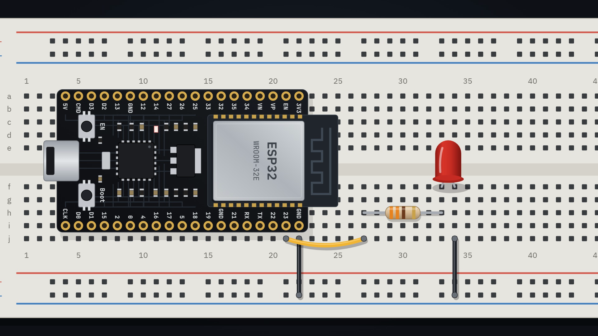
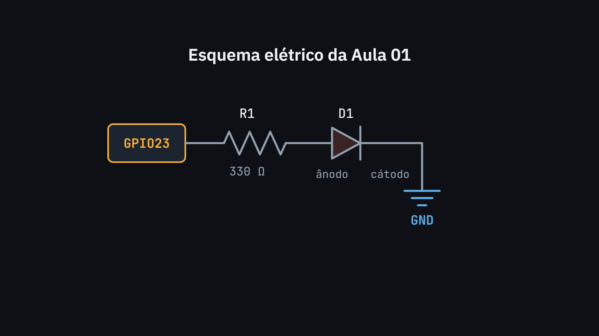

# Aula 01: Do zero ao primeiro LED

Material de apoio da aula **ESP32 do Zero: Entenda a Placa e Faça Seu Primeiro LED Piscar**, do curso **ABC do ESP32**.

Com este material você reproduz o experimento sem assistir ao vídeo de novo.

## O que você vai fazer

Ligar um LED vermelho externo ao GPIO23 de uma ESP32-DevKitC V4 por um resistor de 330 Ω e fazer o LED piscar com um programa escrito por você.



## Lista de componentes

| Qtd. | Item | Observação |
|---|---|---|
| 1 | ESP32-DevKitC V4 com ESP32-WROOM-32E | Versão com pinos machos soldados. Clones e placas de 30 pinos têm outra disposição |
| 1 | LED vermelho | Comum, de 5 mm |
| 1 | Resistor de 330 Ω | 4 faixas: laranja, laranja, marrom. 5 faixas: laranja, laranja, preto, preto |
| 1 | Protoboard de 830 pontos | Confira a seção abaixo sobre largura |
| 3 | Fios jumper | Macho-macho |
| 1 | Cabo Micro-USB de dados | Cabos só de carga não servem |

## Ligações

Monte com o cabo USB desconectado. Todas as colunas abaixo ficam na metade de baixo da protoboard, nas fileiras f a j.

| De | Para |
|---|---|
| GPIO23 (coluna 21) | Fio até a coluna 27 |
| Coluna 27 | Resistor de 330 Ω até a coluna 33 |
| Coluna 33 | Ânodo do LED (perna longa) |
| Coluna 34 | Cátodo do LED (perna curta) |
| Coluna 34 | Fio até a trilha azul (–) |
| GND (coluna 22) | Fio até a trilha azul (–) |

Esquema: `GPIO23 → R1 330 Ω → LED → GND`.



### Encaixe na protoboard

As fileiras de pinos da placa ficam a 25,4 mm uma da outra. Em uma protoboard comum, os pinos entram nas fileiras a e i, e sobra apenas a fileira j livre do lado do GPIO23. É por isso que a montagem usa a fileira j.

Essa medida de protoboard vem de fontes secundárias, e alguns modelos têm canal central diferente. Confira na sua antes de forçar os pinos. Nenhuma montagem física foi testada nesta produção.

## Código

O código completo está em [`firmware/blink/blink.ino`](firmware/blink/blink.ino).

```cpp
const int LED_PIN = 23;

void setup() {
  pinMode(LED_PIN, OUTPUT);
}

void loop() {
  digitalWrite(LED_PIN, HIGH);
  delay(1000);

  digitalWrite(LED_PIN, LOW);
  delay(1000);
}
```

## Conteúdo desta pasta

| Pasta | Conteúdo |
|---|---|
| [`firmware/`](firmware/) | Código-fonte |
| [`circuit/`](circuit/) | Circuito, diagrama e imagem da montagem |
| [`guides/instalacao-ide.md`](guides/instalacao-ide.md) | Instalação do Arduino IDE e seleção de placa |
| [`guides/comandos.md`](guides/comandos.md) | Explicação de cada comando |
| [`guides/erros-e-solucoes.md`](guides/erros-e-solucoes.md) | Erros comuns |
| [`exercises/`](exercises/) | Exercícios e respostas comentadas |
| [`guides/referencias.md`](guides/referencias.md) | Referências oficiais |

## O que foi testado

- Compilação com `arduino-cli 1.5.1` e `esp32:esp32@3.3.12`, sem avisos.
- Execução no QEMU, o emulador do ESP32 mantido pela Espressif, nas variantes 1000/1000, 200/200 e 2000/500 ms, com registro das escritas no GPIO23.

A montagem física ainda não foi testada. Se montar, conte nos comentários do vídeo como foi.
